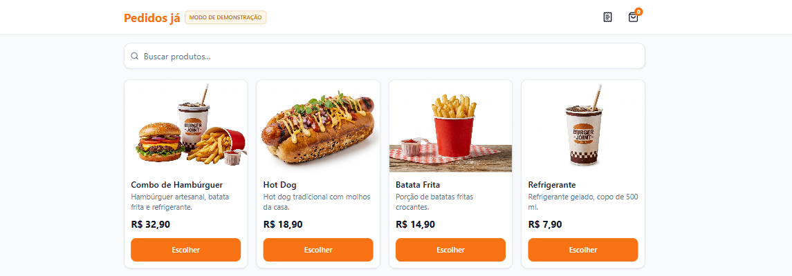
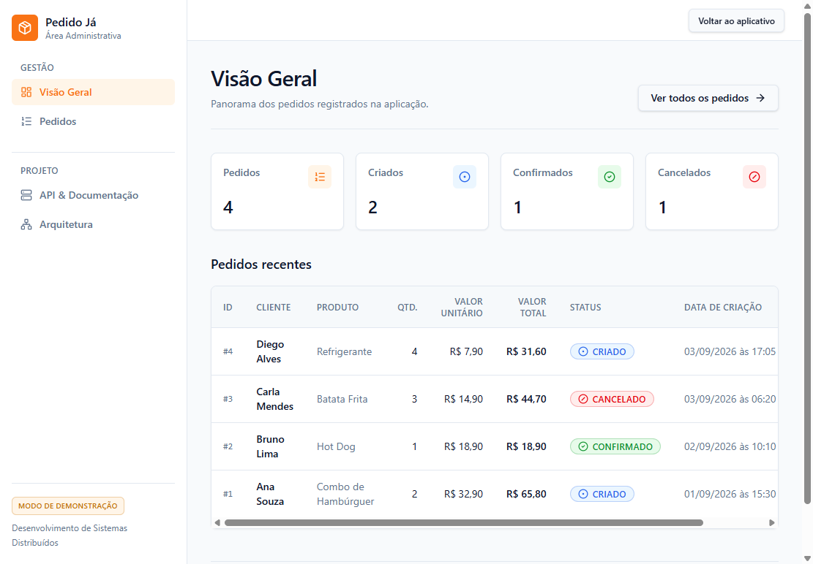

# Pedido Já API

Sistema web acadêmico para criação e acompanhamento de pedidos. O projeto reúne uma API REST em FastAPI, persistência em PostgreSQL e uma interface React para clientes e administração.

> Projeto desenvolvido para a disciplina de Desenvolvimento de Sistemas Distribuídos, no curso de Ciência da Computação. Esta entrega tem escopo demonstrativo e não implementa autenticação.

## Funcionalidades

- Criar pedidos de um produto com quantidade e valor unitário.
- Calcular o valor total e iniciar o pedido com status `CRIADO`.
- Consultar um pedido e listar pedidos existentes.
- Atualizar o status para `CONFIRMADO` ou `CANCELADO`.
- Navegar por um catálogo e rascunhar um pedido na interface do cliente.
- Consultar e atualizar pedidos pela interface administrativa.
- Persistir pedidos no PostgreSQL com schema gerenciado por Alembic.

O catálogo é estático e o carrinho não é persistido no servidor. A área administrativa é apenas uma interface: não há login nem controle de acesso.

## Capturas de tela

As telas abaixo foram capturadas no modo de demonstração e usam pedidos fictícios.





## Tecnologias

- **Backend:** Python 3.12, FastAPI, SQLAlchemy, Pydantic, Alembic e Uvicorn.
- **Banco de dados:** PostgreSQL 16.
- **Frontend:** React 19, TypeScript, Vite, React Router, TanStack Query e Tailwind CSS 4.
- **Testes e qualidade:** pytest, httpx, Vitest, Ruff e ESLint.
- **Execução:** Docker e Docker Compose.

## Executar com Docker

Pré-requisitos: Git e Docker com Docker Compose. Não é necessário instalar Python, Node.js ou PostgreSQL para iniciar a aplicação.

```bash
git clone https://github.com/KaykyCrespo/PEDIDOS_JA_API.git
cd PEDIDOS_JA_API
docker compose up -d --build
```

O Compose inicia o PostgreSQL, executa as migrations e serve o frontend e a API na porta `8000`.

| Endereço | Conteúdo |
| --- | --- |
| <http://localhost:8000/> | Interface do cliente |
| <http://localhost:8000/admin> | Interface administrativa |
| <http://localhost:8000/docs> | Documentação interativa da API |
| <http://localhost:8000/health> | Verificação de saúde |

Para conferir os serviços, execute `docker compose ps`. Para parar os containers sem apagar os dados, execute `docker compose down`. **Não use `docker compose down -v`** se quiser preservar o volume do PostgreSQL.

O guia detalhado está em [docs/COMO_EXECUTAR_PEDIDO_JA.md](docs/COMO_EXECUTAR_PEDIDO_JA.md).

## API

| Método | Rota | Ação |
| --- | --- | --- |
| `GET` | `/health` | Verifica a saúde da aplicação |
| `POST` | `/pedidos` | Cria um pedido |
| `GET` | `/pedidos` | Lista pedidos |
| `GET` | `/pedidos/{id}` | Consulta um pedido |
| `PATCH` | `/pedidos/{id}/status` | Atualiza o status |

O Swagger está disponível em `/docs` e o schema OpenAPI em `/openapi.json`.

## Testes

Os testes unitários do backend podem ser executados com:

```bash
pip install -r requirements.txt
pytest tests/unit
ruff check .
```

Os testes de integração precisam de um PostgreSQL de teste. Configure `TEST_DATABASE_URL` para um banco cujo nome termine em `_test`, conforme as instruções em [tests/integration](tests/integration).

Para testar e validar o frontend:

```bash
cd frontend
npm ci
npm run test
npm run typecheck
npm run lint
npm run build
```

## Estrutura

```text
app/                 API, regras de negócio, persistência e schemas
alembic/             Migrações do banco
tests/               Testes unitários e de integração do backend
frontend/            Aplicação React e testes do frontend
docker/              Inicialização do serviço no container
docs/                Guia de execução e relatório técnico
```

No backend, as responsabilidades seguem o fluxo **API → Service → Repository → PostgreSQL**. O frontend compilado é servido pela própria aplicação FastAPI.

## Configuração e segurança

O arquivo `.env.example` documenta valores de laboratório usados pelo Compose. As credenciais padrão são previsíveis e servem somente para execução local; **não as reutilize em produção**. Guarde configurações e credenciais reais em variáveis de ambiente ou em um arquivo `.env` local, nunca no Git. Arquivos `.env` são ignorados pelo `.gitignore`; os exemplos `.env.example` permanecem versionáveis.

As rotas `/admin` não são protegidas por autenticação. Não exponha esta aplicação como serviço de produção sem implementar autenticação, autorização e configuração segura de credenciais.

## Autoria

Trabalho desenvolvido por Aluísio Pereira Alves, Enzo Orlandi Gomes, Erick de Brito Carvalho e Kayky Crespo dos Santos.
